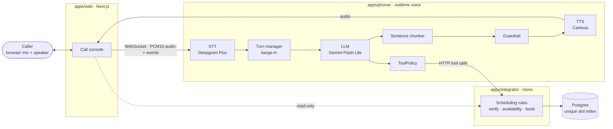

# Hippo

A voice agent that verifies callers and books, cancels or reschedules doctor appointments by phone.



## Repository

| Path                 | What                                                                                            |
| -------------------- | ----------------------------------------------------------------------------------------------- |
| `apps/web`           | Next.js call console: start a call, live transcript, agent responses, tool calls, database view |
| `apps/phoner`        | Realtime voice service (WebSocket): STT → LLM → guardrail → TTS, turn-taking, barge-in          |
| `apps/integrator`    | Scheduling API (Hono): availability, patient verification, appointments                         |
| `apps/e2e`           | Playwright end-to-end tests                                                                     |
| `packages/contracts` | Shared zod schemas: tools, errors, WebSocket protocol                                           |
| `packages/db`        | Drizzle schema, migrations, seed                                                                |
| `packages/ui`        | shadcn/ui components                                                                            |
| `packages/tsconfig`  | Shared TypeScript configs                                                                       |
| `docs/`              | Design docs and ADRs                                                                            |

## Quick start

Requirements: Node 24 LTS, pnpm 12 (`npm i -g pnpm@12`), Docker.

```bash
cp .env.example .env        # add DEEPGRAM_API_KEY, CARTESIA_API_KEY, GEMINI_API_KEY
pnpm install
docker compose up -d db     # local Postgres on 127.0.0.1:54322
pnpm db:migrate && pnpm db:seed
pnpm dev
```

Open http://localhost:3000 and press **Start call**. Without API keys, run with scripted providers:

```bash
LLM_PROVIDER=scripted STT_PROVIDER=none TTS_PROVIDER=silent pnpm dev
```

More in [docs/development.md](docs/development.md).

## Documentation

Start at [docs/README.md](docs/README.md). Highlights: [architecture](docs/architecture.md) · [conversation design](docs/conversation-design.md) · [tools](docs/tools.md) · [concurrency](docs/concurrency.md) · [deployment](docs/deployment.md).

Contributors (and Claude Code) should read [CLAUDE.md](CLAUDE.md).

## Deployment

The web console deploys to Vercel on every merge to `main` (previews on PRs). phoner and integrator run locally for now and are packaged as Docker images for a future Kubernetes deployment. Database migrations are applied to the production Supabase project by GitHub Actions. See [docs/deployment.md](docs/deployment.md).
